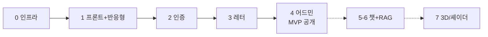

# 포트폴리오 웹 MVP 설계도 — 개요 · 결정 · 로드맵

작성일 2026-10-28 · 작성자 yhy

## 개요와 목표

MVP는 "빌더로서의 yhy를 보여주는 한/영 정적 사이트 + 로그인한 방문자가 레터를 보내고, 내가 어드민에서 읽는 것"까지다. 첫 공개 프로젝트는 이 포트폴리오 자체이며, 만드는 과정이 곧 콘텐츠가 된다.

**포지셔닝**: 특정 분야 개발자가 아닌 빌더·개발자. 기술 스택 나열이 아니라 "무엇을 왜 만들었고 결과가 무엇인가" 단위로 보여준다.

**MVP 범위 (1차)**

- Cloudflare 위에 Astro 정적 사이트, /ko·/en 분리
- 인트로 섹션 1개 + 프로젝트 "이 포트폴리오" 상세
- 이메일(매직링크) + Google 로그인
- 로그인 후 레터 보내기 모달 → 내 메일 + DB 저장
- /admin 간략 대시보드

**2차 이후**: RAG 챗(Haiku), 3D/셰이더 아일랜드, 추가 프로젝트.

**비범위**: 블로그, 댓글, 다중 관리자, 결제, 네이티브 앱.

## 확정된 결정 사항

| 항목 | 결정 | 근거 |
| --- | --- | --- |
| 목표 | MVP | 1차는 정적 사이트 + 로그인 + 레터 + 어드민까지 |
| 인프라 | Cloudflare 단일 (Workers) | Workers(정적 자산 + 동적)·D1·KV·Vectorize·Registrar를 한 계정에서, 월 비용 0에 가깝게. 10/28 Pages에서 전환 — Astro 어댑터가 Pages 지원 중단 |
| 프론트 | Astro | 정적 우선, 상호작용 부분만 React 아일랜드 |
| 언어 | 한/영, /ko·/en 경로 분리 | SEO와 공유 링크에 유리 |
| 도메인 | 브랜드/닉네임 기반, 이름은 미정 | 세계관 콘셉트와 묶어 결정 |
| 디자인 톤 | 하나의 세계관(테마) | 콘셉트는 별도 세션에서 딥하게 논의 |
| UI 레퍼런스 | Mobbin | 화면 패턴 참고용(코드 아님). 실제 구현은 Tailwind + CSS 라이브러리 |
| UI 라이브러리 | daisyUI 5 (10/29 확정) | 순수 CSS Tailwind v4 플러그인 — JS 0KB, CSP 문제 없음. 테마는 CSS 변수라 세계관이 정해지면 커스텀 테마로 교체. 다이내믹 효과는 daisyUI가 아니라 View Transitions·scroll-driven animations(CSS), 필요한 곳만 지연 로드 JS로 |
| 인증 | 이메일 매직링크 + Google OAuth | Better Auth, 메일은 Resend |
| 로그인 기능 | 레터 모달, 어드민 대시보드 | 방문자 → 나 연락 채널 + 내 관리 화면 |
| 첫 프로젝트 | 이 포트폴리오 자체 | 문서 준비 부담 최소, 빌더 메시지 직접적 |
| 챗/RAG | 후순위, Haiku API | 작은 벡터 + 키워드 검색 가능해야 함 |
| 3D/셰이더 | 옵션, 기초 수준 소급 적용 | 아일랜드로 나중에 끼워도 구조 영향 없음 |
| 레포 | GitHub Public, pnpm | 코드 자체가 포트폴리오, 비밀은 전부 환경변수 |
| 구현 방식 | Claude가 구현, 본인은 프로세스 이해·판단 | 세부 구현 지식은 필수 아님 |
| MVP 구현 (10/29) | 1–4단계 로컬 구현·검증 완료. Astro i18n 라우팅 미사용, React 아일랜드는 `client:demand`, CSP는 Astro 해시, 로그인 수는 KV | 각 단계 문서의 "구현 메모 (10/29)" |
| 인증·레터·어드민 상세 (10/28) | 제자리 복귀 + 시트 자동 재개, 개인정보 페이지 + 계정 삭제, 사이트 내 답장, 첨부 불허, Telegram 알림, 단순 HTML 메일, Cloudflare 기본 로그 | 각 단계 문서의 "상세 설계 (확정)" 참조 |

## 구성 한눈에

```mermaid
flowchart LR
  B["방문자 브라우저<br/>Astro 정적 HTML + React 아일랜드"] --> P["Workers 정적 자산<br/>/ko, /en"]
  B --> F["Worker 코드<br/>/auth /api /admin SSR"]
  F --> D1[("D1<br/>유저·세션·레터")]
  F --> KV[("KV<br/>레이트리밋")]
  F --> R["Resend<br/>매직링크·레터·답장"]
  F --> G["Google OAuth"]
  F --> T["Telegram 알림"]
  F -.2차.-> V[("Vectorize")]
  F -.2차.-> AI["Workers AI 임베딩"]
  F -.2차.-> H["Anthropic Haiku"]
```

하나의 Worker가 정적 자산과 동적 요청을 함께 받는다. 정적 페이지는 Workers 정적 자산으로 바로 나가고, 동적 경로만 Worker 코드가 처리한다. Worker 코드만 D1·KV·외부 서비스에 닿고, 비밀은 전부 Worker 시크릿에 있다. 서비스별 한도와 배포 흐름은 [00-infra.md](00-infra.md) 참조. 점선은 2차(MVP 이후)에 추가되는 요소다.

## 단계별 로드맵

각 단계는 앞 단계의 완료 기준을 통과한 뒤 시작한다. 3→4가 챗보다 앞에 오는 이유는 인증만 있으면 완성되는 반면, 챗은 비용·프롬프트 튜닝이 따라붙어 꼬리가 길기 때문이다.

**단계별 상세 문서**

| 단계 | 문서 |
| --- | --- |
| 0 인프라 | [00-infra.md](00-infra.md) |
| 1 프론트 + 반응형 | [01-frontend.md](01-frontend.md) |
| 2 인증 | [02-auth.md](02-auth.md) |
| 3 레터 | [03-letters.md](03-letters.md) |
| 4 어드민 (MVP 완료) | [04-admin.md](04-admin.md) |
| 5–6 챗 + RAG | [05-06-chat-rag.md](05-06-chat-rag.md) |
| 7 3D/셰이더 | [07-3d-shader.md](07-3d-shader.md) |
| 공통 데이터·환경변수·보안 | [common.md](common.md) |

운영 공개 절차는 [guides/mvp-launch.md](guides/mvp-launch.md), 챗·RAG 연동은 [guides/chat-rag-setup.md](guides/chat-rag-setup.md).

큰 기능(인증, 레터, 어드민, 챗+RAG, 3D)은 각각 독립 문서이고, 데이터 모델·환경변수·보안은 common.md에서 한 번만 관리한다.

## 미결정 사항과 2차 디테일

**착수 전 결정 (0단계 블로커)**

- [ ] 브랜드/닉네임과 도메인 — 후보 검토 중
- [ ] 세계관 콘셉트 — 별도 디자인 세션
- [x] CSS 라이브러리 — daisyUI 5, UI 레퍼런스는 Mobbin (10/29)
- [ ] 레터 수신 메일 주소와 관리자 이메일

**2차 디테일 (해당 단계에서 질의로 채움)**

| 영역 | 정할 것 | 어느 단계 |
| --- | --- | --- |
| 콘텐츠 | 인트로 한 줄 문구(한/영), 프로젝트 "이 포트폴리오" 문제·접근·결과 본문 — 초안 작성됨, 다듬기 필요 | 1 |
| 콘텐츠 | 변경 이력(빌드 로그)을 git 커밋에서 자동 생성할지 수동 작성할지 — 지금은 프로젝트 마크다운 frontmatter `changelog`에 수동 | 1 |
| SEO | OG 이미지(정적 vs 동적 생성), `sitemap`, `hreflang`, robots | 1 |
| 분석 | Cloudflare Web Analytics(쿠키 없음) 사용 여부 | 1 |
| RAG | 청크 크기 튜닝, 스택 경험 수준 표기 방식 | 6 |
| 3D | 효과 종류·색감 — 세계관 콘셉트에 종속 | 7 |
| 접근성 | 키보드 포커스 순서, 스크린리더 레이블, 색 대비 4.5:1 | 전 단계 |
